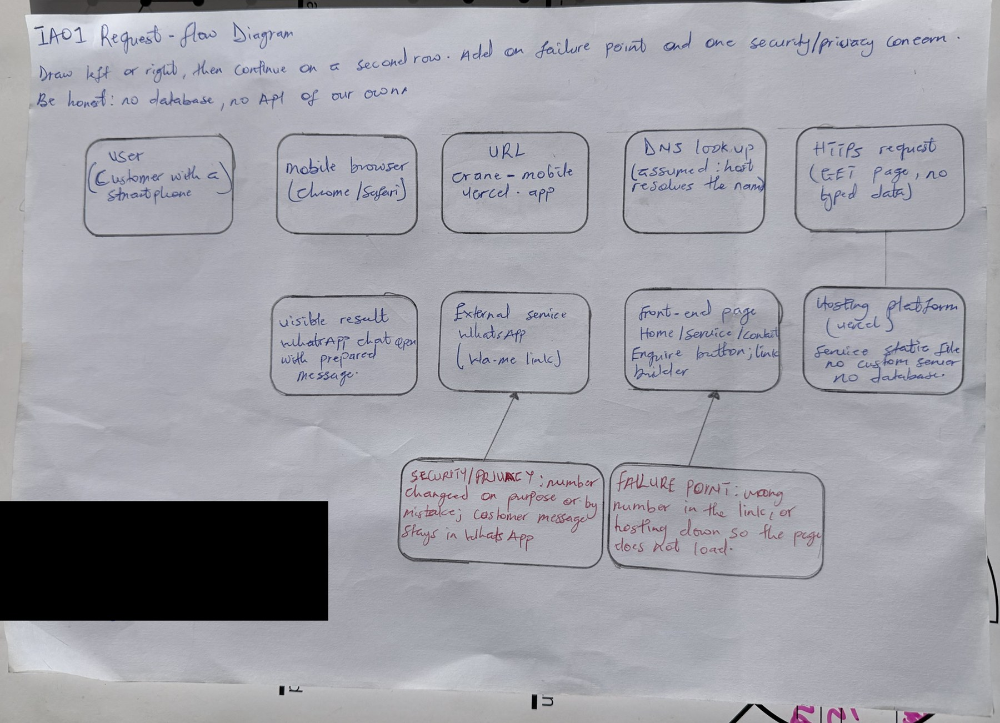

# IA01: Personal System Request-Flow Diagram

**Identity:** jpkanquandah, team Intellectuals, project LiftPro Crane Services Website, date 23 October 2026, feature: customer enquires about a crane service (the time is written on the original drawing kept in Sakai).

## Handwritten diagram

{width="5.833333333333333in" height="4.219444444444444in"}

IA01 handwritten request-flow diagram

**AI note on this drawing:** I drew this by hand myself. The layout was based on a reference sketch that Claude suggested, and I can explain every box and arrow in my own words.

## Typed explanation: the twelve questions

Feature: a customer opens the LiftPro Crane Services website on a phone, looks at the Services section and taps Enquire, and WhatsApp opens with a prepared message for the owner. The site is a static site with no back end and no database, so some steps below say “none”. Anything planned is marked as planned.

**1. User device:** The customer’s phone, usually an Android phone on mobile data, because the client’s customers find the site from his TikTok and Instagram posts. The site must therefore work well on a small screen and a slow connection. I check the layout on a narrow phone screen because that is the device I design for as the frontend developer, and I also assume the phone may have a cracked or small screen and a slow network.

**2. Browser or mobile app:** A mobile browser such as Chrome or Safari, often the in-app browser that TikTok or Instagram opens when someone taps a link. There is no separate mobile app. WhatsApp is the second app involved, opened at the end.

**3. URL, route or screen:** The page https://crane-mobile.vercel.app/ and its Services section. The screen is the list of services, each with an Enquire button. The button is an ordinary link to a wa.me address, so no server route or endpoint of our own is called. In the browser the route is simply the site’s home page. The Enquire button is an anchor element whose address is built from the service name, so the tap is handled by the phone, not by our code on a server. For example, the general enquiry link on the live site is https://wa.me/233XXXXXXXXX?text=Hello%2C%20I%20would%20like%20to%20request%20a%20crane%20service, which opens a chat with the owner and the message already typed.

**4. Protocol:** HTTPS for loading the page from the host (Vercel). The Enquire tap then opens a wa.me HTTPS link, which the phone hands to the WhatsApp app. DNS turns the domain name into the host’s address first; I assume the host’s normal DNS and routing and do not run my own. HTTPS matters here because it stops someone on public Wi-Fi from changing the page, and with it the number, on the way to the customer. The domain name is crane-mobile.vercel.app, a Vercel address, and I assume that Vercel’s servers answer it.

**5. Data sent:** To load the page: only a normal GET request with browser headers. On Enquire: nothing is sent to our site at all. The wa.me link itself carries the owner’s approved number and the encoded message text, for example “Hello, I would like to ask about Mobile Crane Hire.” The customer chooses whether to send it. Nothing the customer types is ever sent to us, because the site has no form. This is deliberate, because the client asked only for services and a WhatsApp button.

**6. Request validation:** There is no server-side validation because our server receives no form data. Validation happens in the front-end code: the service must exist in the content list, the message is URL-encoded so spaces and symbols do not break the link, and the number comes from one configuration place. This is checked by tests and by pull request review. As a frontend developer I treat the link builder as the one place where bad input could cause harm, so I keep the number in a single configuration place and encode the message with encodeURIComponent.

**7. Table, collection or service:** No database table or collection. The services and the number are held in the site’s content file in the source code. The only external service is WhatsApp, which receives the customer’s message after the customer sends it. A possible Enquiry record is planned for a later version only and is not built.

**8. Returned response:** The host returns static HTML, CSS, JavaScript and images, not JSON, because there is no API. The visible result is the Services page. After the tap, WhatsApp shows a chat with the owner and the message ready to edit and send. The visible result is judged by the customer on a phone, so I check that the Enquire buttons appear without scrolling sideways and that tapping them opens WhatsApp quickly.

**9. Validation failure:** If a service id is unknown or missing, the front end falls back to the general message (“Not sure? Ask the owner”) instead of breaking. If the number or encoding is wrong, the failure is meant to be caught by the tests in CI and by review before it is merged. The customer sees a general message to the owner rather than an error page, which keeps the path to a conversation open even when something small is wrong.

**10. Database outage:** There is no database to fail. The comparable outage is the host being down, in which case the page does not load and the customer can still reach the owner through his TikTok or Instagram accounts. If WhatsApp is not installed, the phone shows the WhatsApp web page and the Contact section still shows the number.

**11. 500 concurrent users:** The site is static files served by Vercel’s network, so 500 people viewing it at once is mainly a bandwidth question, not a processing one, and should be fine. I have not load tested it, so this is reasoning, not measured evidence. The real limit would be the owner answering 500 WhatsApp chats, which is outside our system. Keeping images small matters most on mobile data. Large images would be the first thing to slow things down, so I compress photos and avoid heavy scripts. I would also test with several phones on slow data before claiming it works for many visitors at once.

**12. Security or privacy concern:** The biggest concern is that the owner’s number is wrong or replaced, which would send customers’ messages to a stranger. We reduce this with one configuration place, tests on the number, required pull request reviews and two-factor authentication. For privacy, the site asks for and stores no personal data. A second concern is that the page should not load unknown third-party scripts that could track visitors. I plan to check the browser network tab for unexpected requests before each release.

## Oral explanation

Video (2 to 3 minutes, no slides, unlisted YouTube): https://youtu.be/bMEDxWQgDD4. In the video I state my name, team, feature, the path, one failure point (a wrong number in the link), one security concern (the number being replaced) and one thing I still need to learn (how to load test a static site).

## Team evidence, branch and AI disclosure

Branch ia1-jpkanquandah-request-flow; commit “IA1: add jpkanquandah individual evidence”; PR “IA1 Evidence - jpkanquandah”: (link in the Sakai portfolio). Team files to update: docs/09-system-design/01-request-flow.md and docs/09-system-design/individual-request-flows/.

**AI used:** Yes. Claude (Anthropic), 23 October 2026: helped me turn my team’s documents into the typed answers above and suggested the reference layout for the drawing. I kept only statements that match our static-site design, changed the wording to my own, and drew and recorded the evidence myself. Verified against the team charter (D0) and the live site address.

