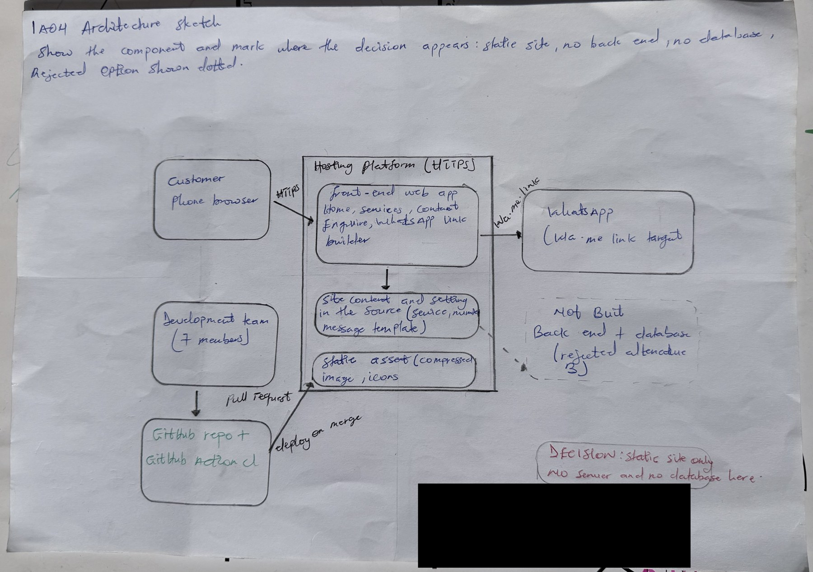

# IA04: Architecture Decision Record and Failure Walkthrough

**Identity:** jpkanquandah, team Intellectuals, LiftPro Crane Services Website. Personal repository: https://github.com/Dept-of-Comp-Sci-University-of-Ghana/DE-IND-jpkanquandah. Team repository: https://github.com/Dept-of-Comp-Sci-University-of-Ghana/dcit208-client-project-2026-team-engineering-repository-intellectuals. Related team issue: (link in the Sakai portfolio). Date: 23 October 2026.

## ADR title and status

**ADR: Build the website as a static site that opens WhatsApp, with no back end and no database.** Status: Accepted.

## Context and assumptions

**Client problem:** Bernard Nyantakyi gets the same questions about services and prices in his DMs and has no single place that shows his services. **Feature:** Enquire button that opens WhatsApp with a prepared message. **Requirement:** a button that sends visitors to his WhatsApp line (D2) and NFR-24 (no customer data stored by the site). **Why the decision matters:** it decides the cost, security, maintenance and how fast we can deliver.

**Assumptions and constraints:**

-   Users: customers on phones, with limited data. Client: not technical, one person.
-   Data: services text, images and one WhatsApp number; no customer data.
-   Deployment and cost: free or very cheap hosting (the free Vercel plan is limited to non-commercial use, ADR-003).
-   Team: 7 students with web skills but a short deadline (a few weeks, four sprints).
-   Privacy: avoid collecting personal data. Scale: small, mostly local enquiries.

## Alternatives and decision matrix

-   **Option A (chosen):** static front end plus a wa.me link.
-   **Option B (rejected):** web app with a back end and database that stores enquiries and bookings.
-   **Option C (rejected for now):** WhatsApp chatbot and automated replies.

Weights: 5 is very important, 1 is not important. Scores: 1 is poor and 5 is excellent. Weighted score is weight times score.

  -----------------------------------------------------------------------------------------------------------------------------------------------------------------------
  Criterion                 Weight   A: static + WhatsApp   B: back end + database   Evidence and reasoning
  ------------------------- -------- ---------------------- ------------------------ ------------------------------------------------------------------------------------
  Fit with client need      5        5 (25)                 3 (15)                   Client asked only for services plus a WhatsApp button; bookings were not requested

  Security and privacy      5        5 (25)                 2 (10)                   A stores no customer data; B must protect a database and personal data

  Maintainability           4        4 (16)                 2 (8)                    Fewer parts to break or update for a non-technical client

  Team skill and deadline   4        5 (20)                 3 (12)                   Static pages are quick to finish in four sprints

  Deployment and cost       3        4 (12)                 2 (6)                    Free static hosting versus paying for server and database

  Performance and scale     3        5 (15)                 3 (9)                    Static files are fast and cheap to serve

  **Total**                          **113**                **60**                   Option C was not scored because it was out of scope (D2)
  -----------------------------------------------------------------------------------------------------------------------------------------------------------------------

**Decision and balance:** Option A. We chose simplicity, privacy and speed over features.

-   **Benefits:** very low risk, low cost, no customer data to protect, fast pages.
-   **Disadvantages and limits:** no booking, no availability, no prices, and the owner cannot see whether a message was read. Content changes need a maintainer.
-   **New work:** a content file kept in source, tests for the link builder, someone trained to update content.
-   **Revisit if:** the client wants bookings, prices that change often, or an admin page.

## Personal architecture sketch

{width="5.833333333333333in" height="4.106018153980752in"}

IA04 handwritten architecture sketch

**AI note on this drawing:** I drew this by hand myself. The layout was based on a reference sketch that Claude suggested, and I can explain every box and arrow in my own words.

## Failure walkthrough

  ---------------------------------------------------------------------------------------------------------------------------------------------------------
  Step                                Answer
  ----------------------------------- ---------------------------------------------------------------------------------------------------------------------
  User action and normal path         Customer taps Enquire; browser follows the link; WhatsApp opens with the message

  Failing component                   The WhatsApp number in the configuration is wrong after a bad merge

  Detection                           Tests TC-06 and TC-19 fail in CI; if it slips through, the owner notices enquiries missing or a customer reports it

  What the user sees                  A chat with the wrong person, or no chat

  Data at risk                        No stored data; the risk is lost customers and a customer’s message going to a stranger

  Logs                                CI run logs, the pull request history, the host’s deployment log

  Immediate mitigation and recovery   Revert the pull request or redeploy the previous version on the host; confirm by clicking every Enquire link

  Test of the failure handling        A unit test checks every generated link starts with the approved number
  ---------------------------------------------------------------------------------------------------------------------------------------------------------

## Verification plan

1.  Run the unit tests for the link builder (make test).
2.  Check CI passes on the pull request.
3.  Open the deployed site on a phone and click each Enquire button.
4.  Ask the client to confirm the number shown and the service names.

## Video, commits and declaration

-   Video (unlisted, 3 to 4 minutes): https://youtu.be/bMEDxWQgDD4.
-   Three meaningful commits made by me as I finished each part: IA4: add jpkanquandah context and alternatives ((link in the Sakai portfolio)); IA4: add jpkanquandah decision and consequences ((link in the Sakai portfolio)); IA4: add jpkanquandah final evidence ((link in the Sakai portfolio)).
-   Files: IA04/evidence/architecture-sketch.pdf and IA04/submission/EVIDENCE.md.
-   **AI used:** Yes. Claude (Anthropic), 23 October 2026: drafted the decision matrix and wording from our team documents. I checked the scores against our own reasoning, kept the weights, and verified the decision against the client’s request in D0 and the hosting choice in our ADR.
-   Declaration: “I confirm that this submission is based on my team’s actual client project. I have identified all AI assistance used. I can explain the decision, alternatives, trade-offs, failure scenario and evidence in my own words.”

