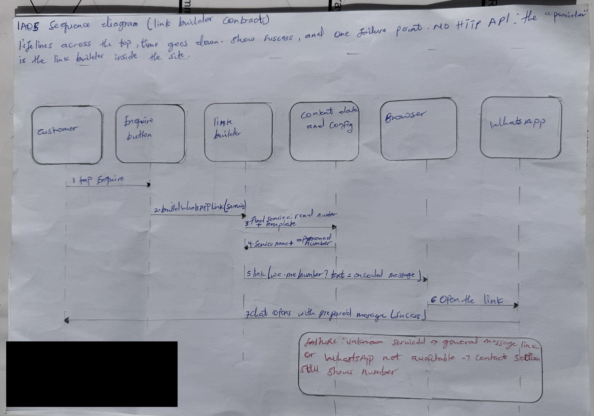

# IA05: API Contract and Failure-Response Walkthrough

**Identity:** jpkanquandah, team Intellectuals. Repositories: https://github.com/Dept-of-Comp-Sci-University-of-Ghana/DE-IND-jpkanquandah and https://github.com/Dept-of-Comp-Sci-University-of-Ghana/dcit208-client-project-2026-team-engineering-repository-intellectuals. Story: customer enquires about a service. Issue: (link in the Sakai portfolio). Date: 23 October 2026.

**Honest note:** the website has no HTTP API. The “caller and provider agreement” for this feature is the WhatsApp link builder, a function inside the site that the Enquire button calls. The task allows a non-HTTP equivalent, so I define that contract. I use the descriptive name buildWhatsAppLink for it; the site code may name or inline this logic differently, which does not change the contract.

## Purpose and contract

  -----------------------------------------------------------------------------------------------------------------------------------------------------------------------------------------------------------------------------
  Item                         Definition
  ---------------------------- ------------------------------------------------------------------------------------------------------------------------------------------------------------------------------------------------
  Role, goal, value            As a customer, I want Enquire to open WhatsApp with the right number and a message about my service, so I do not type it all

  Caller                       The Enquire button on the Services section (and the “Not sure?” button)

  Provider                     The link builder function in the front-end code

  NFR or constraint            Always use the approved number (NFR-12); store nothing (NFR-24)

  Operation                    buildWhatsAppLink(serviceId) returns a link string (non-HTTP equivalent of GET /enquiry-link)

  Final link form              https://wa.me/\<approved number, digits only\>?text=\<URL-encoded message\> (example: https://wa.me/233XXXXXXXXX?text=Hello%2C%20I%20would%20like%20to%20ask%20about%20Mobile%20Crane%20Hire.)

  Path or query parameters     serviceId (text, required for a service enquiry; omitted for the general message)

  Headers and authentication   None. The function runs in the visitor’s browser.

  Authorization                None for visitors. Changing the number or service list is controlled by GitHub review and CODEOWNERS.
  -----------------------------------------------------------------------------------------------------------------------------------------------------------------------------------------------------------------------------

**Request fields:**

  --------------------------------------------------------------------------------------------------------------------------------------------------
  Field                       Type             Required   Meaning
  --------------------------- ---------------- ---------- ------------------------------------------------------------------------------------------
  serviceId                   text             Optional   Id of a service in the site content, for example “mobile-crane-hire” (synthetic example)

  Message template (config)   text             Required   The fixed sentence with a place for the service name

  Number (config)             text of digits   Required   Approved WhatsApp number, international format, no plus or spaces
  --------------------------------------------------------------------------------------------------------------------------------------------------

## Validation rules (5)

  -------------------------------------------------------------------------------------------------------------------------
  \#   Rule                                                                          Kind       Checked by
  ---- ----------------------------------------------------------------------------- ---------- ---------------------------
  1    serviceId must be text                                                        Type       link builder

  2    serviceId must match a service in the content list                            Business   link builder

  3    The number must be digits only, 10 to 15 digits                               Format     config check or test

  4    The message must be URL-encoded so spaces and symbols do not break the link   Format     link builder, tests TC-08

  5    The number used must be the approved number                                   Business   tests TC-06 and TC-19
  -------------------------------------------------------------------------------------------------------------------------

## Success response

Outcome: a link is returned and the browser opens WhatsApp. Synthetic example response:

    {
      "ok": true,
      "link": "https://wa.me/233000000000?text=Hello%2C%20I%20would%20like%20to%20ask%20about%20Mobile%20Crane%20Hire.",
      "service": "Mobile Crane Hire"
    }

Fields: ok says it worked; link is what the button opens; service is the name used in the message. Next display: WhatsApp opens with the message ready to edit. (The real function may return only the link string. The JSON is how I describe the contract.)

## Error cases (5)

  ----------------------------------------------------------------------------------------------------------------------------------------------------------------------------------------------------------------------------------------
  Case                                                               Outcome                                     Error code                 User-facing message                                  Logging
  ------------------------------------------------------------------ ------------------------------------------- -------------------------- ---------------------------------------------------- -----------------------------------------
  Invalid input: serviceId is not text                               No link; fall back to the general message   ERR_INVALID_SERVICE_ID     “Please ask the owner about this service.”           Console warning in development

  Authorization: someone tries to change the number without review   Change is blocked by branch protection      ERR_REVIEW_REQUIRED        Not visible to visitors; shown on the pull request   GitHub audit trail

  Conflict: serviceId matches two services (duplicate id)            Build or test fails                         ERR_DUPLICATE_SERVICE      Not shown to visitors; the change cannot be merged   CI log

  External service failure: WhatsApp cannot open                     Phone shows the WhatsApp page or an error   ERR_WHATSAPP_UNAVAILABLE   Contact section still shows the number               None on the site (nothing is collected)

  Missing configuration: number is empty                             Build or test fails                         ERR_NUMBER_MISSING         Not shown to visitors                                CI log
  ----------------------------------------------------------------------------------------------------------------------------------------------------------------------------------------------------------------------------------------

**Status of each error case:** ERR_REVIEW_REQUIRED is enforced today by GitHub branch protection and CODEOWNERS. The other codes (ERR_INVALID_SERVICE_ID, ERR_DUPLICATE_SERVICE, ERR_NUMBER_MISSING) are the names I give to checks that are planned in the link builder and CI tests, not confirmed in the code. ERR_WHATSAPP_UNAVAILABLE is a behaviour of the phone and WhatsApp, not of our code.

## Duplicates and retries

If a customer taps Enquire twice, two chats may open, but nothing is stored, so there is no duplicate record. The function is idempotent (the same input always gives the same link). A retry is **safe** because it only builds a link. There is no unique constraint or request id because there is no data. The one unsafe retry is the customer sending the same WhatsApp message several times, which is outside our system.

## Hand-drawn sequence diagram

{width="5.833333333333333in" height="4.093055555555556in"}

IA05 handwritten sequence diagram

**AI note on this drawing:** I drew this by hand myself. The layout was based on a reference sketch that Claude suggested, and I can explain every box and arrow in my own words.

## Contract tests (6)

  ------------------------------------------------------------------------------------------------------------------------------------------------------------------------------------
  \#   Test                       Input                                                   Expected outcome and response
  ---- -------------------------- ------------------------------------------------------- --------------------------------------------------------------------------------------------
  1    Valid request              serviceId = existing service                            ok true; link starts with wa.me and the approved number; message contains the service name

  2    Missing or invalid field   serviceId = number 123                                  ERR_INVALID_SERVICE_ID; general message link

  3    Unauthorized change        Pull request that edits the number without a reviewer   Merge blocked (process test: branch protection and CODEOWNERS)

  4    Conflict or duplicate      Two services with the same id                           CI fails with ERR_DUPLICATE_SERVICE

  5    Dependency failure         Open the link on a phone without WhatsApp               Phone shows the WhatsApp page; Contact section still shows the number

  6    Response shape             Valid request                                           Result contains ok, link and service with the right types
  ------------------------------------------------------------------------------------------------------------------------------------------------------------------------------------

## Trade-off, video and files

-   **Trade-off and open question:** a function contract is simple but it cannot protect us if someone edits the number in the source, so we rely on review. Open question: should the number be stored only in one configuration file with its own automated check, or is review enough for a small project?
-   Video (3 to 4 minutes): https://youtu.be/bMEDxWQgDD4.
-   Files: IA05/API_CONTRACT.md, ERROR_MODEL.md, TEST_PLAN.md, examples/request.json, examples/success-response.json, examples/error-response.json, evidence/sequence-diagram.pdf, AI_DISCLOSURE.md.
-   **AI used:** Yes. Claude (Anthropic), 23 October 2026: drafted the contract tables from my team’s documents. I changed names and examples to use synthetic values only, and marked planned checks as planned. I have not verified the function against the source code, which is why the contract is described as a design.

