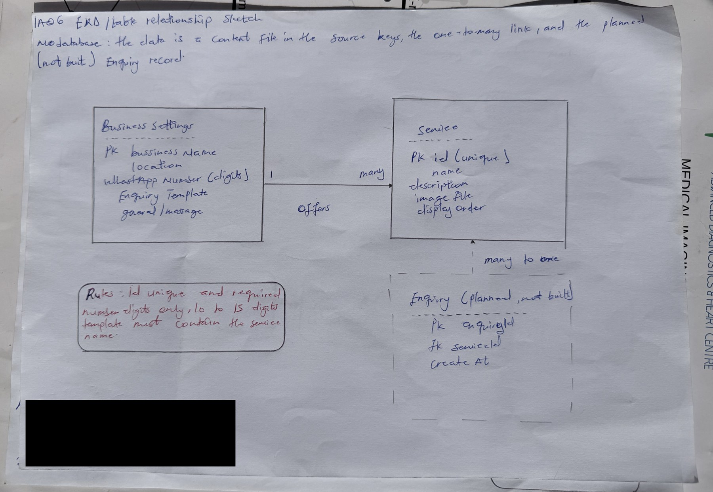

# IA06: Data Model, Query and State Walkthrough

**Identity:** jpkanquandah, team Intellectuals. Feature: Enquire about a service. Story: customer enquires about a service. Issue: (link in the Sakai portfolio). Repositories: https://github.com/Dept-of-Comp-Sci-University-of-Ghana/DE-IND-jpkanquandah and https://github.com/Dept-of-Comp-Sci-University-of-Ghana/dcit208-client-project-2026-team-engineering-repository-intellectuals. Date: 23 October 2026.

**Honest note:** the site has no database. Its “data” is a content file in the source (services, business details and the message template). I model that, and I list a possible Enquiry record as *planned for a later version only*.

## Entities, attributes and relationships

  ---------------------------------------------------------------------------------------------------------------------------------------------------------------------------------------
  Entity                              Attributes (type)                                                                                                   Key
  ----------------------------------- ------------------------------------------------------------------------------------------------------------------- -------------------------------
  BusinessSettings                    businessName (text), location (text), whatsappNumber (digits text), enquiryTemplate (text), generalMessage (text)   one record, key: businessName

  Service                             id (text), name (text), description (text), imageFile (text), displayOrder (number)                                 id (unique)

  Enquiry (planned only, not built)   enquiryId, serviceId, createdAt                                                                                     enquiryId
  ---------------------------------------------------------------------------------------------------------------------------------------------------------------------------------------

**Relationship:** one BusinessSettings offers many Services (one-to-many). Each Service appears once in the list. The planned Enquiry would link many-to-one to a Service.

{width="5.833333333333333in" height="4.028240376202975in"}

IA06 handwritten ERD sketch

**AI note on this drawing:** I drew this by hand myself. The layout was based on a reference sketch that Claude suggested, and I can explain every box and arrow in my own words.

## Constraints and synthetic sample data

  -------------------------------------------------------------------------------------------------
  Rule                                                        Where enforced
  ----------------------------------------------------------- -------------------------------------
  id is required and unique                                   content check and unit test (build)

  name is required and not empty                              content check and tests

  whatsappNumber is digits only, 10 to 15 digits              config check, tests TC-06 and TC-19

  enquiryTemplate must contain a place for the service name   tests TC-08

  imageFile must exist                                        build step

  Only the approved number may be used                        tests and code review
  -------------------------------------------------------------------------------------------------

All records below are **synthetic** (made up for this report).

  -----------------------------------------------------------------------------------------------------------
  id                  name                               description                           displayOrder
  ------------------- ---------------------------------- ------------------------------------- --------------
  sample-crane-hire   Mobile Crane Hire (sample)         Crane and operator for lifting jobs   1

  sample-heavy-lift   Heavy Equipment Lifting (sample)   Lifting and placing heavy equipment   2
  -----------------------------------------------------------------------------------------------------------

  -----------------------------------------------------------------------
  businessName             location          whatsappNumber
  ------------------------ ----------------- ----------------------------
  LiftPro Crane Services   Madina, Ghana     233000000000 (synthetic)

  -----------------------------------------------------------------------

**Lifecycle:** records are created by editing the content file in a pull request, change when the client approves new text, and are removed by deleting them in a pull request. Every change is reviewed and kept in Git history.

## Query and state walkthrough

**Action:** the customer taps Enquire on a service.

1.  **Input:** the service id from the button.
2.  **Data touched:** the Service list and BusinessSettings.
3.  **Rule applied:** the id must exist; the template is filled with the service name; the whole message is URL-encoded.
4.  **Retrieval:** the code finds the service by id and reads the number and template from settings.
5.  **Response:** a WhatsApp link, opened by the browser.

No state is stored; the page shows the same thing every time.

## Privacy, failures and tests

**Sensitive data:** the WhatsApp number (public once the client approves, NFR-11) and the client’s private evidence (call notes, screenshots). Who may view or edit: anyone can view the public data; only team members through reviewed pull requests can edit. **Must not go into AI tools:** the client’s real private phone details, passwords or tokens, and customer chats.

**Two realistic failures:**

1.  *Duplicate service id:* the wrong service name could appear in a message. The build or test should fail so it is not merged.
2.  *Missing or badly formatted number* (for example starting with 0 or a plus sign): the link would not open the right chat. The config test fails and the change is blocked.

**Six test ideas:**

1.  Every service has a unique id (constraint).
2.  Every service has a non-empty name (validation).
3.  The number is digits only and the right length (validation).
4.  A service name with spaces, an ampersand and an accent is encoded correctly (query).
5.  No customer data appears in the repository or the page (privacy).
6.  If the service id is unknown, the general message is used (failure handling).

## Video, evidence and AI disclosure

-   Video (3 to 4 minutes): https://youtu.be/bMEDxWQgDD4. Sketch: inserted above. Editable work: IA06/.
-   **AI used:** Yes. Claude (Anthropic), 23 October 2026: drafted the entities and sample data. I replaced real values with synthetic ones and checked the entities against our D0 charter and the services the client described. I did not inspect the real content file.

