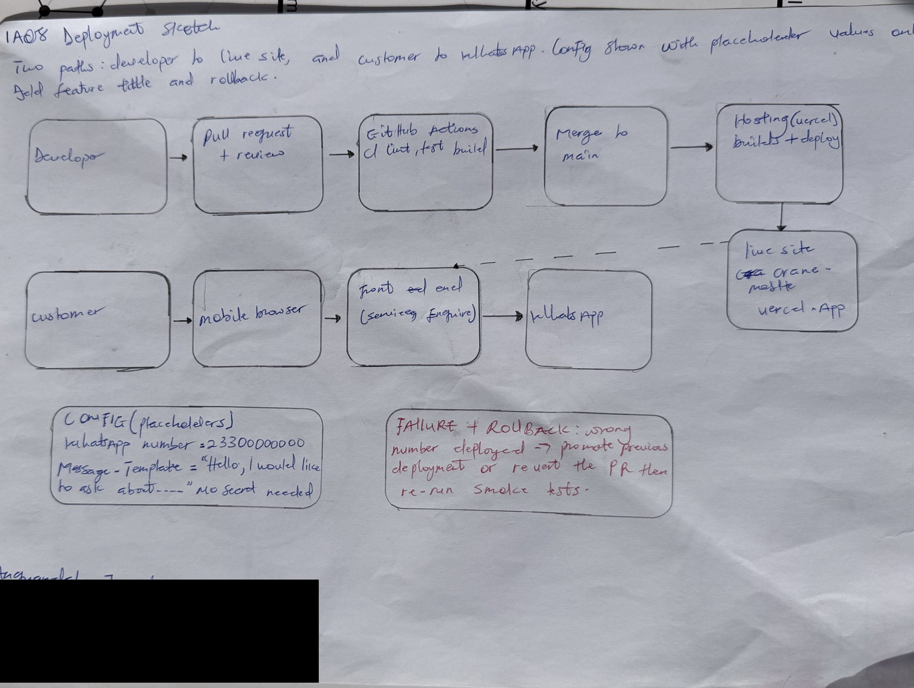

# IA08: Deployment Readiness, Release Evidence and Rollback Walkthrough

**Identity:** jpkanquandah, team Intellectuals. Repositories: https://github.com/Dept-of-Comp-Sci-University-of-Ghana/DE-IND-jpkanquandah and https://github.com/Dept-of-Comp-Sci-University-of-Ghana/dcit208-client-project-2026-team-engineering-repository-intellectuals. Related issue, PR and release: (link in the Sakai portfolio). Date: 23 October 2026.

## Feature and status

**Feature:** customer enquires about a service by WhatsApp. **Status:** deployed at https://crane-mobile.vercel.app/. The release tags I plan to cite are v0.1-prototype, v0.2-beta, v0.3-staging, v0.9-rc and v1.0-demo; I will list only the ones that exist in the repository: (link in the Sakai portfolio).

## Configuration and secrets

  ------------------------------------------------------------------------------------------------------------------------------------
  Setting                      Example (placeholder)                           Secret?
  ---------------------------- ----------------------------------------------- -------------------------------------------------------
  WhatsApp number              233000000000                                    No (public once approved), but protected by review

  Message template             “Hello, I would like to ask about {service}.”   No

  Business name and location   LiftPro Crane Services, Madina                  No

  Hosting account login        not in the repository                           Yes; kept by the owner with two-factor authentication
  ------------------------------------------------------------------------------------------------------------------------------------

The site needs no keys, tokens or passwords. If one is ever needed it goes in the host’s environment settings, never in the repository.

## Hand-drawn deployment sketch

{width="5.833333333333333in" height="4.391202974628172in"}

IA08 handwritten deployment sketch

**AI note on this drawing:** I drew this by hand myself. The layout was based on a reference sketch that Claude suggested, and I can explain every box and arrow in my own words.

## Deployment steps and smoke tests

**Run locally:** make setup, then make test, then start the site with the run command in the README. No database or migration is needed.

**Platform settings:** Vercel builds the site and deploys it when the team merges to the main branch, using the build settings stored for the project.

**Smoke tests (six):**

  ------------------------------------------------------------------------------------------------------------------------
  \#   Check                                                   Expected
  ---- ------------------------------------------------------- -----------------------------------------------------------
  1    Open the live URL over https                            Padlock shows; home page loads

  2    Tap Enquire (valid input)                               WhatsApp opens with the approved number and service name

  3    Tap “Not sure? Ask the owner”                           General message opens

  4    Open a page that does not exist (invalid input)         A clear “page not found”, not a blank page

  5    Access control: try to edit the number without review   Blocked by branch protection

  6    System error: open the site with the network off        Browser error; no crash of other pages after reconnecting
  ------------------------------------------------------------------------------------------------------------------------

## Failure and rollback

-   **Failure:** a bad merge deploys a version where Enquire links use the wrong number.
-   **Symptom:** a tester or the owner finds enquiries going to another number, or smoke test 2 fails.
-   **Likely cause:** the number was edited or the config was changed in a pull request.
-   **Evidence to inspect:** the pull request diff, CI results, the host’s deployment list.
-   **Immediate response:** promote the previous good deployment on the host, or revert the pull request.
-   **Corrective action:** fix the config, add a test, merge through review.
-   **Recovery confirmed by:** re-running all six smoke tests and the owner confirming the number.

## Release evidence, handoff and defence

-   **Evidence:** tag (link in the Sakai portfolio), release note (link in the Sakai portfolio), commit (link in the Sakai portfolio), PR (link in the Sakai portfolio), CI run (link in the Sakai portfolio).
-   **Logs and health checks:** Vercel’s deployment log; a smoke test after each deployment (the six checks above) is the health check. An uptime monitor is planned and not yet set up.
-   **Backups:** the content is in Git history, so the repository is the backup.
-   **Support and limitations:** no booking or prices, free hosting may not allow business use (ADR-003), content changes need a maintainer.
-   Video (3 to 4 minutes): https://youtu.be/bMEDxWQgDD4.
-   **AI used:** Yes. Claude (Anthropic), 23 October 2026: drafted this section. AI was not allowed to touch the client’s accounts, credentials or real private details. I changed the wording to match our hosting, and checked the live address and the failure steps against what I know of our deployment.

