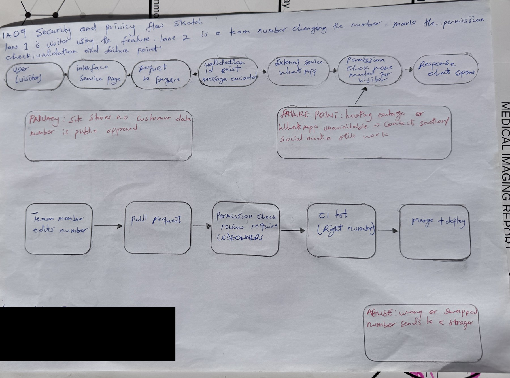

# IA09: Security, Privacy and Maintainability Review

**Identity:** jpkanquandah, team Intellectuals. Feature: Enquire about a service. Repositories: https://github.com/Dept-of-Comp-Sci-University-of-Ghana/DE-IND-jpkanquandah and https://github.com/Dept-of-Comp-Sci-University-of-Ghana/dcit208-client-project-2026-team-engineering-repository-intellectuals. Issue or PR: (link in the Sakai portfolio). Date: 23 October 2026.

## Requirement and acceptance criteria

Story: As a customer, I want to tap Enquire on a crane service so that I can ask the owner in WhatsApp. AC1: the link uses the approved number and the service name. AC2: the site stores no customer data and the Contact section stays available if WhatsApp cannot open.

## Data inventory (synthetic or public data only)

  -----------------------------------------------------------------------------------------------------------------------------------------------------------------------------------
  Data                                Purpose                      Sensitivity            Storage                       Access                   Synthetic or real
  ----------------------------------- ---------------------------- ---------------------- ----------------------------- ------------------------ ------------------------------------
  Business name, services, location   Show what is offered         Public                 Repository and host           Public view, team edit   Real, public

  WhatsApp number                     Start an enquiry             Public once approved   Config file                   Public view, team edit   Real in production; synthetic here

  Customer message and number         The enquiry                  Personal               WhatsApp only, not our site   Customer and owner       Not held by us

  Visitor logs and statistics         Hosting and errors           Low to medium          Host                          Hosting owner            Real, provider’s

  Client evidence                     Show requirements are real   Private                Team repository               Team and lecturer        Real, redacted
  -----------------------------------------------------------------------------------------------------------------------------------------------------------------------------------

## Access-control matrix

  --------------------------------------------------------------------------------------------------------------------------------------------------------------------------------------------------
  Role                                             Create                   View                Update                   Delete                   Approve            Export       Manage
  ------------------------------------------------ ------------------------ ------------------- ------------------------ ------------------------ ------------------ ------------ ------------------
  Visitor                                          No                       Yes (public site)   No                       No                       No                 No           No

  Team member                                      Yes (via pull request)   Yes                 Yes (via pull request)   Yes (via pull request)   No                 No           No

  Reviewer or code owner                           Yes                      Yes                 Yes                      Yes                      Yes (merge)        No           Repository rules

  Hosting owner (named person, later the client)   No                       Yes                 Yes (deploy settings)    Yes                      Yes (deployment)   Yes (logs)   Yes
  --------------------------------------------------------------------------------------------------------------------------------------------------------------------------------------------------

## Abuse and privacy risk

**Risk:** impersonation. Someone copies the site and changes the number to their own, or a person edits the number in our repository.

**How it happens:** a copied site shared on social media, or an unreviewed change to the config.

**Harm:** customers send their messages and phone numbers to a stranger; the client loses trust and jobs.

**Prevention:** one config place for the number; tests for the number; required reviews and CODEOWNERS; two-factor authentication on GitHub and the host; the client shares only the official link and reports copies to the host.

## Failure, verification and maintenance

**Failure:** the hosting platform has an outage. **User sees:** the site does not load. **Data preserved:** all content is in Git, and nothing from customers is lost because we keep none. **Logs:** host status page and deployment logs. **Recovery:** wait for or fix the host, or redeploy from main; the owner is still reachable through social media.

**Five checks and review questions:**

1.  Does every Enquire link use only the approved number? (tests TC-06 and TC-19)
2.  Does any page ask for passwords, payment or unneeded personal data? (NFR-09, TC-18)
3.  Is two-factor authentication on for every member and the hosting account?
4.  Are there unexpected third-party scripts when I open the network tab?
5.  Is anything secret or private in the repository history?

**Maintainer and client handoff note:** to change a service or the number, edit the content file and open a pull request, then wait for review. Limitations: no booking, prices or read receipts; free hosting may not allow business use (ADR-003); someone must be trained to update the content. Future improvement: train a helper, add real photos, and consider prices or booking only if the client wants them.

## Sketch, video and AI disclosure

{width="5.833333333333333in" height="4.329629265091864in"}

IA09 handwritten security and privacy flow sketch

**AI note on this drawing:** I drew this by hand myself. The layout was based on a reference sketch that Claude suggested, and I can explain every box and arrow in my own words.

-   Video (3 to 4 minutes): https://youtu.be/bMEDxWQgDD4.
-   Files: IA09/ (sanitized review, ID-redacted sketch).
-   **AI used:** Yes. Claude (Anthropic), 23 October 2026: drafted the tables. I changed the access matrix and risk to match our team roles, and kept all data synthetic or public. Checks still to do on the real project: two-factor settings, the network tab for third-party scripts and the repository history.

